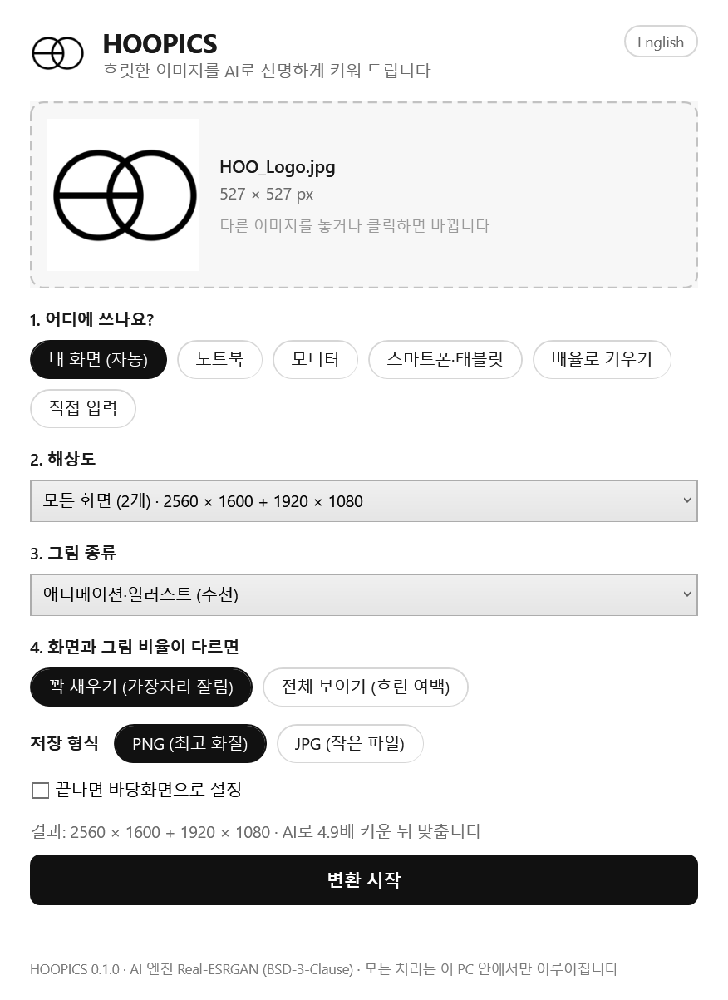

# HOOPICS

**흐릿한 이미지를 내 화면 크기에 꼭 맞게, AI로 선명하게 키워 드립니다.** 이미지를 끌어다 놓고 어디에 쓸지
(내 화면, 노트북, 모니터, 스마트폰)만 고르면 됩니다.

Windows 10/11 · 설치할 것 없음 · 모든 처리는 내 PC 안에서 · [MIT 라이선스](./LICENSE) ·
[English](./README.md)

| 일반적인 방법으로 확대 | HOOPICS로 확대 |
|---|---|
|  |  |

---

## 사용 방법

1. 이 페이지 위쪽의 **Code → Download ZIP**을 눌러 내려받고, 원하는 곳에 압축을 풉니다.
   Git이나 Python은 필요 없습니다.
2. **`start.bat`** 를 더블클릭합니다. 이미지를 `start.bat` 위로 끌어다 놓아도 됩니다.
3. 어디에 쓸지 고르고 **변환 시작**을 누릅니다.

결과는 원본과 같은 폴더에 `원본이름_2560x1600.png` 처럼 저장됩니다("배율로 키우기"는 `원본이름_x2.png`).
기존 파일은 절대 덮어쓰지 않고, 다시 만들면 `원본이름_2560x1600 (2).png` 처럼 번호가 붙습니다.

**처음 한 번만** AI 엔진(약 43MB)을 [Real-ESRGAN 공식 배포처](https://github.com/xinntao/Real-ESRGAN/releases/tag/v0.2.5.0)에서
내려받습니다. 내려받은 파일은 SHA-256 값으로 위변조 여부를 확인한 뒤 사용하고, 그다음부터는 인터넷 없이도 동작합니다.

> **"Windows의 PC 보호" 창이 뜨나요?** `start.bat` 에 디지털 서명이 없어서 처음 한 번 뜰 수 있습니다.
> **추가 정보 → 실행** 을 누르면 됩니다.

---

## 고를 수 있는 것

| 항목 | 설명 |
|---|---|
| **내 화면 (자동)** | 연결된 모든 화면의 실제 해상도를 알아내서 화면마다 이미지를 하나씩 만듭니다. *끝나면 바탕화면으로 설정* 을 켜면 각 화면에 맞는 이미지가 바탕화면으로 바로 적용됩니다. |
| **노트북 / 모니터 / 스마트폰·태블릿** | 자주 쓰는 해상도 모음: HD~5K, 16:10, 3:2, 21:9·32:9 울트라와이드, 맥북, 갤럭시, 아이폰, 아이패드 |
| **배율로 키우기** | 비율은 그대로 두고 2배, 3배, 4배로 키웁니다. |
| **직접 입력** | 가로 × 세로를 16~16384 사이에서 마음대로 정합니다. |
| **꽉 채우기 / 전체 보이기** | *꽉 채우기* 는 화면 비율에 맞춰 가장자리를 고르게 잘라냅니다(Windows 배경 "채우기"와 같음). *전체 보이기* 는 그림 전체를 보여 주고 남는 공간은 흐리게 처리한 같은 그림으로 채웁니다. |
| **그림 종류** | 애니메이션·일러스트(기본), 더 선명한 애니메이션용, 실제 사진용 중에서 고릅니다. |

- 여러 이미지나 폴더를 통째로 넣으면 같은 설정으로 한 번에 처리합니다.
- JPG, PNG, WEBP, BMP, GIF, TIFF를 읽고 PNG(무손실) 또는 JPG로 저장합니다.
- 휴대폰으로 찍어 옆으로 누운 사진은 바로 세우고, PNG의 투명 배경은 그대로 유지합니다.
- 화면 언어는 Windows 언어 설정을 보고 한국어나 영어로 정해집니다. 오른쪽 위 버튼으로 언제든 바꿀 수 있습니다.

## 필요한 것

- Windows 10 또는 11 (64비트). HOOPICS가 쓰는 PowerShell 5.1과 WPF는 Windows에 기본으로 들어 있습니다.
- Vulkan을 지원하는 그래픽 카드. 최신 드라이버가 깔린 NVIDIA, AMD, Intel 그래픽이면 대부분 됩니다.

## 자주 묻는 질문

**변환이 실패해요.** 그래픽 드라이버 문제인 경우가 많습니다. NVIDIA/AMD/Intel 홈페이지에서 최신 드라이버를 설치한 뒤 다시 해 보세요.

**결과는 어디에 저장되나요?** 원본 이미지가 있는 폴더입니다. 끝나면 나오는 **결과 폴더 열기** 버튼으로 바로 열 수 있습니다.
원본 폴더에 저장할 수 없으면 `사진\HOOPICS` 폴더에 저장합니다.

**이미지가 너무 작다고 나와요.** AI 확대는 최대 16배까지입니다. 그보다 큰 확대가 필요하면 더 큰 원본을 써 주세요.

**인터넷으로 이미지가 전송되나요?** 아니요. 모든 처리는 내 PC 안에서만 이루어집니다. 인터넷은 처음 한 번 AI 엔진을 내려받을 때만 씁니다.

**지우고 싶어요.** 압축을 푼 폴더를 지우면 끝입니다. 언어 설정을 바꾼 적이 있다면 `%APPDATA%\HOOPICS` 폴더도 지우세요.

---

## 라이선스와 오픈소스

HOOPICS는 [MIT 라이선스](./LICENSE)로 공개되어, 누구나 자유롭게 쓰고 고치고 나눌 수 있습니다.

화면, 해상도 프리셋, 화면 감지, 맞춤·자르기, 바탕화면 설정, 엔진 자동 설치 같은 HOOPICS 자체 기능은 이 저장소에서 새로 만든 코드입니다.
실제로 그림을 키우는 AI는 오픈소스인 Real-ESRGAN(BSD 3-Clause)과 그 실행 엔진(MIT), ncnn(BSD 3-Clause), libwebp(BSD 3-Clause)를 씁니다.
이 라이선스들의 원문은 [THIRD_PARTY_NOTICES.md](./THIRD_PARTY_NOTICES.md)에 있습니다. HOOPICS는 이들 저작자와 관계가 없으며, 그들의 보증을 받은 프로그램도 아닙니다.

명령줄 사용법과 개발 방법은 [영어 README](./README.md#command-line)에 있습니다.
