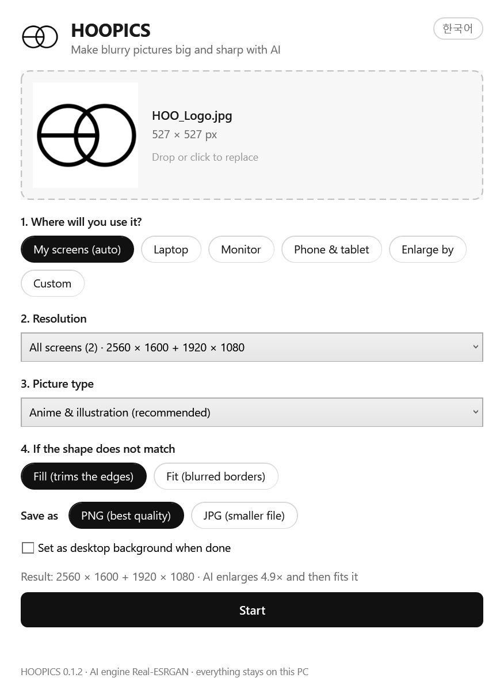
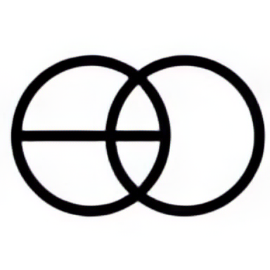

# HOOPICS


**Make blurry pictures big and sharp, sized for your exact screen.** Drop an image, pick where it
goes (your own screens, a laptop, a monitor, a phone), and HOOPICS enlarges it with AI and fits it
pixel-perfect.

Windows 10/11 · nothing to install · runs entirely on your PC · [MIT](./LICENSE) ·
[한국어 안내 (Korean)](./README.ko.md)

> **This is the `hoo-engine` development branch.** HOOPICS runs here on its own engine (Microsoft ONNX
> Runtime with DirectML) while new models are being prepared, and it does not include models yet. To use
> HOOPICS, download [the latest release](https://github.com/WhoisHOO/HOOPICS/releases/latest). The plan is
> in [docs/ROADMAP.md](docs/ROADMAP.md).

<p align="center"></p>

| Enlarged the usual way | Enlarged with HOOPICS |
|---|---|
|  |  |

---

## Quick start

1. **Code → Download ZIP**, then extract it anywhere. *You do not need Git or Python.*
2. Double-click **`start.bat`**, or drag images straight onto it.
3. Pick where the picture will be used and press **Start**.

Results are saved next to the original as `name_2560x1600.png` (or `name_x2.png` for "Enlarge by").
Nothing is ever overwritten; a second run makes `name_2560x1600 (2).png`.

The first run downloads the AI engine (about 16 MB): Microsoft's ONNX Runtime, DirectML and Visual C++
runtime, taken unmodified from Microsoft's own packages and published with HOOPICS. HOOPICS checks the
SHA-256 of the download and of every file in it. After that it works offline.

> **Windows blocks `start.bat`?** Windows marks files from the internet, and with Smart App Control on it
> refuses to run a marked `start.bat`. Delete the extracted folder, right-click the downloaded ZIP, choose
> **Properties**, tick **Unblock**, click **OK** and extract it again. If SmartScreen asks instead, click
> **More info → Run anyway**.

---

## What it does

| Option | |
|---|---|
| **My screens (auto)** | Detects every connected screen at its real pixel size and makes one image per screen. Tick *Set as desktop background* to apply each image to its own screen. |
| **Laptop / Monitor / Phone & tablet** | Common sizes: HD to 5K, 16:10, 3:2, ultrawide 21:9 and 32:9, MacBook, Galaxy, iPhone and iPad. |
| **Enlarge by** | 2×, 3× or 4×, keeping the shape. |
| **Custom** | Any width × height from 16 to 16384. |
| **Fill / Fit** | *Fill* crops evenly to the exact shape, like the Windows *Fill* wallpaper style. *Fit* keeps the whole picture over a blurred, dimmed copy of itself. |
| **Picture type** | Anime & illustration (default), an extra-sharp anime model, or photo. |

- Drop several images or a whole folder; every image gets the same settings.
- Reads JPG, PNG, WEBP, BMP, GIF and TIFF; saves PNG (lossless) or JPG.
- Phone photos stored sideways are turned upright (EXIF orientation); transparency is kept in PNG.
- Korean and English, picked from your Windows languages; switch any time with the button in the corner.

## Requirements

- Windows 10 or 11, 64-bit. PowerShell 5.1 and WPF, which HOOPICS is built on, ship with Windows.
- Any DirectX 12 graphics card (NVIDIA, AMD or Intel) makes it fast. Without one, or if the graphics
  card fails during a picture, HOOPICS finishes on the CPU, which is slower.

---

## How it works

1. The picture is read, turned upright, and saved as a PNG in a private temporary folder, so the
   engine only ever reads files that HOOPICS wrote itself.
2. The AI model runs at its native 4× on the GPU through Microsoft's
   [ONNX Runtime](https://onnxruntime.ai) with DirectML, twice in a row when more than 4× is needed (up
   to 16×). It works in tiles of 256 px, each with a margin of the picture around it so the seams do
   not show. The engine (`app/engine`) is C# that Windows PowerShell compiles and loads from memory,
   so every program file Windows loads is signed by Microsoft. It picks fp16 or fp32 by measuring
   both on the first picture, checks every tile, and moves to the CPU if the GPU fails.
3. The result is resampled to the exact target size with high-quality bicubic filtering, then
   cropped (*Fill*) or padded (*Fit*).

Running the 4× model and scaling down came out cleaner in our tests than the engine's own 3× model,
which left halos around outlines.

Screen sizes come from the Windows desktop-wallpaper API (`IDesktopWallpaper`), which reports real
pixels. With mixed display scaling, for example a 150% laptop next to a 100% monitor, a
system-DPI-aware program asking the usual screen APIs sees the second screen 1.5× too big.

## Command line

The window and the command line share one pipeline (`app/HOOPICS.Core.psm1`).

```powershell
# One image for a 2560x1600 screen
powershell -ExecutionPolicy Bypass -File app\hoopics-cli.ps1 photo.jpg -Size 2560x1600

# One image per connected screen, then set each as that screen's background
powershell -ExecutionPolicy Bypass -File app\hoopics-cli.ps1 art.png -Screens -SetWallpaper

# Every JPG in a folder, 2x, photo model, saved as JPG
powershell -ExecutionPolicy Bypass -File app\hoopics-cli.ps1 C:\pics\*.jpg -Scale 2 -Model photo -Format jpg
```

Other options: `-Model anime|anime-sharp|photo`, `-Mode fill|fit`, `-OutDir <folder>`.

## Project layout

| Path | |
|---|---|
| `start.bat` | Launcher: double-click it, or drop files on it |
| `app/HOOPICS.ps1` | The window: events, background worker, progress |
| `app/MainWindow.xaml` | Window layout (WPF) |
| `app/strings.json` | Every visible text, in Korean and English |
| `app/HOOPICS.Core.psm1` | Engine install, presets, screen detection, image pipeline |
| `app/Native.cs` | Win32/COM helpers: real screen sizes and per-screen wallpaper |
| `app/hoopics-cli.ps1` | Command line |
| `app/engine/` | The AI engine: `HoopicsEngine.cs`, started through `hoopics-engine.ps1` |
| `tests/` | Pester 5 tests; the engine tests use a tiny test model on the CPU, so no GPU is needed |
| `dev/` | Developer tools: the runtime build, the test model, comparisons with the old engine |
| `engine/` | Downloaded on first run, not in git |

## Development

```powershell
Install-Module Pester -MinimumVersion 5.5 -Scope CurrentUser
Import-Module .\app\HOOPICS.Core.psm1; Install-HoopicsEngine   # the engine tests need the runtime
Invoke-Pester -Path tests
```

Until HOOPICS has its own models, develop with the Real-ESRGAN models of HOOPICS 0.1.1: run 0.1.1 once
so it installs them, then convert them into `engine/models` with `dev/parity/ncnn_to_onnx.py` (Python
with numpy). `dev/parity/Compare-Engines.ps1` compares the old and the new engine.

Keep `.ps1`, `.psm1`, `.xaml` and `.cs` files ASCII-only: Windows PowerShell 5.1 reads files
without a BOM in the system code page. Put visible text in `app/strings.json`, in both languages;
a test checks that both have the same keys.

---

## Privacy

Everything runs on your PC. The only network request HOOPICS makes is the one-time engine
download from github.com. ONNX Runtime's usage events are turned off; see
[THIRD_PARTY_NOTICES.md](./THIRD_PARTY_NOTICES.md#engine-runtime) for the details.

## License

HOOPICS is released under the [MIT License](./LICENSE). The engine runtime it downloads is
Microsoft's: ONNX Runtime (MIT), DirectML (Microsoft's DirectML license), four .NET libraries (MIT)
and the Visual C++ runtime (Visual Studio redistributable terms). Details and license texts are in
[THIRD_PARTY_NOTICES.md](./THIRD_PARTY_NOTICES.md). HOOPICS is not affiliated with or endorsed by
their authors.
